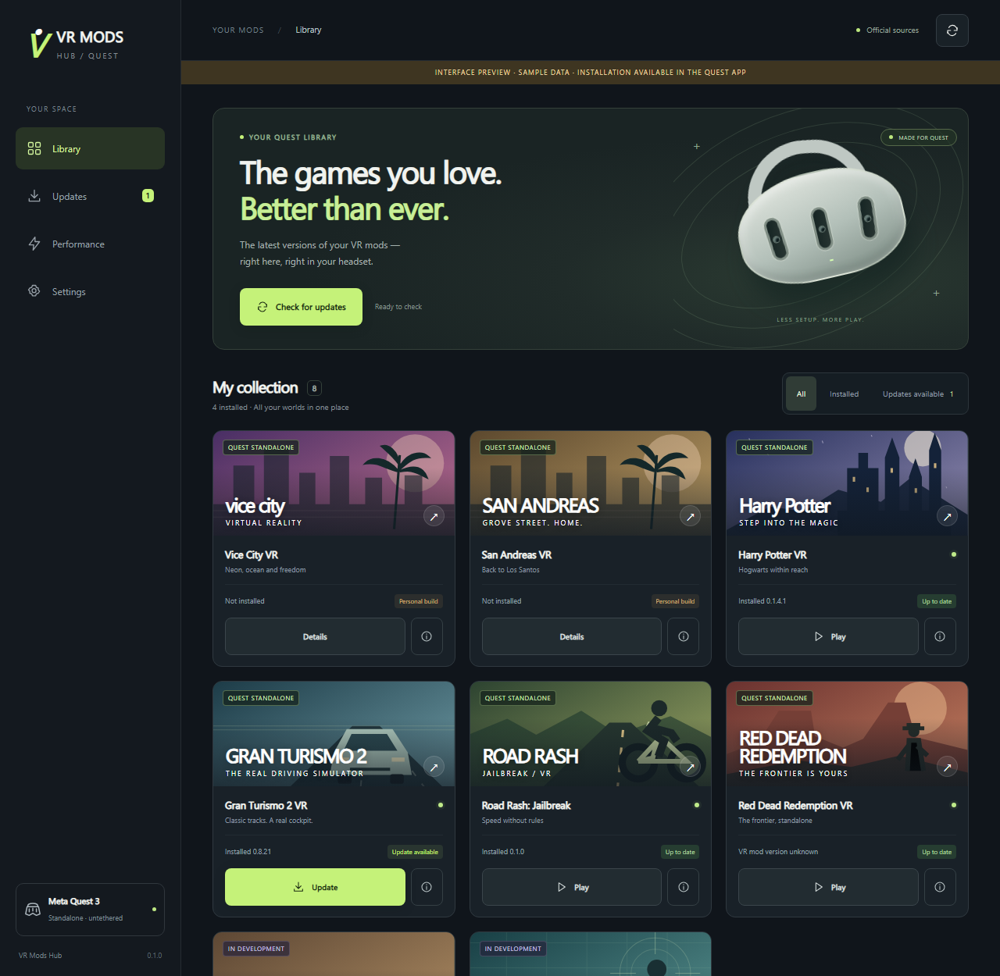

# VR Mods Hub

VR Mods Hub is an app for Meta Quest that installs and updates VR mods right on the headset. It runs as a normal panel in Horizon OS.

*The Hub's library screen (interface preview with sample data).*

## Status: 0.1.0, first release

- **Only Red Dead Redemption VR (RDR1) has been tested end to end**, on Quest 3 and Quest 3S.
- The other games in the library are listed but not tested with this release. Treat them as experimental.
- This is an early release. Expect rough edges and report problems.

## The Hub contains no game files

The Hub itself contains **no game files**: no game data, no game APKs and no copyrighted game content.

For RDR1 the Hub builds the VR version on the headset from two sources:
- **your own installed copy of the game** (the Rockstar / Google Play edition of Red Dead Redemption);
- **the mod author's signed pack**, downloaded from the mod's official GitHub release.

The Hub checks the author's signature and the hashes of your game files before it builds anything, then signs the result with a key that is created on your headset.

## Installing the Hub

1. Download `VR-Mods-Hub-0.1.0.apk` from the [Releases](https://github.com/dubrovskiy-yevhen-stakelogic/vr-mods-hub/releases) page.
2. Install it on your Quest as an app from unknown sources.
3. Open **VR Mods Hub** from the Unknown sources section of your library.

The Hub updates itself from the releases of this repository. When a new version is out, a banner appears in the Hub.

## RDR1: what the Hub does

| Your RDR1 on the headset | What the Hub offers |
| --- | --- |
| The original game, no VR mod | **Install VR mod**: builds and installs the VR version. Saves of the original game are not carried over. |
| The VR mod installed by the Hub | **Update VR mod**: installs the new version in place. Your saves stay. |
| The VR mod installed from a PC build (for example 0.2.0 or 0.3.0) | **Reinstall with saves**: reinstalls the VR mod with the Hub's key and moves your saves. **Reinstall without saves** is also offered. |

During a reinstall the Quest asks you to confirm twice: once to remove the old build, once to install the new one. Confirm each window once, then wait. Installing about 8 GB takes a minute or two.

### Connecting the headset (once)

Moving the saves of a mod built on a PC, and the GPU boost, need a debugging connection to the headset. The Hub sets it up with you, step by step, inside the headset:

1. Unlock Android developer options: **About headset → tap Build number 7 times**.
2. Open **Developer options → Debugging**, tap the words **Wireless debugging**, turn on **Use wireless debugging**.
3. Tap **Pair device with pairing code** and type the 6 digits into the Hub.

The Hub opens the right settings screen for each step and finds the pairing window by itself. Pairing is needed once. After a headset restart, only turn **Wireless debugging** on again.

### Saves

- With the connection, the Hub copies your saves out of the old build and puts them into the new one. No game start is needed for the copy.
- After the install the Hub asks you to **start RDR once to its main menu, quit, and press Continue**. The first start shows the Rockstar screens again; this is normal.
- A copy of your saves is also kept in `Documents/VRModsHub/rdr1-saves/` on the headset.
- If the game has no saves, the reinstall simply goes on without them.

### GPU boost

RDR VR needs the GPU boost to hold its frame rate. **Start RDR from the Hub**: the Hub always starts it with the boost. Without a connection it opens the connection window first.

